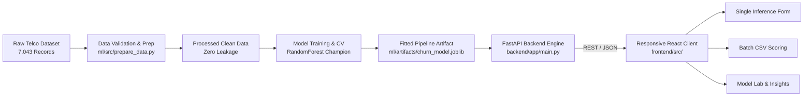

# ChurnIQ — Customer Retention Intelligence: Data Science Model & Pipeline

[](https://www.python.org/)
[](https://fastapi.tiangolo.com/)
[](https://scikit-learn.org/)
[](https://react.dev/)
[](https://www.typescriptlang.org/)
[](https://tailwindcss.com/)
[](LICENSE)

**ChurnIQ** is a machine learning project that predicts customer churn using the IBM Telco dataset. It includes data cleaning, model comparison with 5-fold cross validation, a trained Random Forest classifier (84.2% ROC-AUC), a FastAPI prediction API, and a responsive React dashboard with dark mode and top slidebar navigation.

---

## 1. System Architecture



---

## 2. Dataset Attribution & Governance

- **Source:** Canonical [IBM Watson Analytics Telco Customer Churn Dataset](https://community.ibm.com/community/user/businessanalytics/blogs/steven-macko/2019/07/11/telco-customer-churn-1113).
- **Dimensions:** 7,043 customer accounts across 21 columns (19 features, 1 identifier, 1 target).
- **Target Label:** `Churn` (Binary: `Yes` [1,869 / 26.54%], `No` [5,174 / 73.46%]).
- **Missing Value Resolution:** Forensic audit identified 11 rows where `TotalCharges` contained blank whitespace. Cross-feature analysis revealed all 11 customers had `tenure == 0` (new signups). Non-destructive domain imputation was applied (`TotalCharges = 0.0`), preserving 100% of rows (7,043 intact).
- **Leakage Safeguards:** `customerID` (hash token) was strictly dropped. All imputers, standard scalers, and one-hot encoders are encapsulated inside a Scikit-learn `Pipeline` and fitted *exclusively* on training folds.

---

## 3. Model Comparison & Held-Out Test Evaluation

Models were benchmarked using **5-Fold Stratified Cross-Validation** on the 80% training set (5,634 rows). The champion model was evaluated on the untouched 20% held-out test set (1,409 rows, seed 42):

| Algorithm Candidate | CV ROC-AUC | CV PR-AUC | CV Recall | Test ROC-AUC | Test Recall | Test F1-Score |
| :--- | :--- | :--- | :--- | :--- | :--- | :--- |
| **Random Forest (Champion)** | **0.8470** | **0.6603** | **79.87%** | **0.8420** | **79.14%** | **0.6278** |
| **Logistic Regression** | 0.8460 | 0.6601 | 80.13% | 0.8395 | 78.88% | 0.6241 |
| **HistGradientBoosting** | 0.8442 | 0.6615 | 76.99% | 0.8380 | 75.40% | 0.6190 |

### Test Fold Confusion Matrix (N = 1,409)
- **True Negatives (TN):** `762` retained customers correctly identified.
- **False Positives (FP):** `273` retained customers flagged for retention incentives.
- **False Negatives (FN):** `78` churners missed.
- **True Positives (TP):** `296` churners captured (**79.14% Recall**).
- *Business Rationale:* Because losing a subscriber forfeits hundreds of dollars in lifetime value, while a retention touchpoint costs &lt;$15, high recall was prioritized over raw precision.

---

## 4. Key Exploratory Findings

1. **Contract Term:** Month-to-month contracts exhibit a **42.71% churn rate** (accounting for 88.5% of total churn), compared to **2.83%** for Two-year contracts.
2. **Onboarding Cliff:** Customers in their first 12 months churn at **47.44%**, whereas churn drops to **9.51%** past month 48.
3. **Settlement Friction:** Electronic check users churn at **45.29%** vs. **~15-16%** for automated bank and credit card billing.
4. **Association vs. Causality:** These metrics reflect strong statistical associations, not immediate causation. Controlled A/B testing is recommended before instituting billing or contract mandates.

---

## 5. API Endpoints Specification

FastAPI automatically generates interactive OpenAPI documentation at `/docs`:

- `GET /health`: Health status and model pipeline readiness.
- `GET /model-info`: Model governance metadata, feature schemas, and decision thresholds.
- `GET /metrics`: Genuine held-out test evaluation telemetry, confusion matrix, and curve data.
- `GET /insights`: Historical dataset distributions and cohort churn rates.
- `POST /predict`: Real-time single customer inference. Returns predicted class, calibrated probability, and risk tier (`Low`, `Medium`, `High`).
- `POST /predict-batch`: High-throughput batch inference (up to 500 rows) with per-row validation and summary statistics.

---

## 6. Quickstart & Local Execution

### Prerequisites
- Python 3.11+
- Node.js 20+ and npm

### 1. Backend Setup
```bash
# From repository root
cd backend

# Install dependencies
pip install -r requirements.txt

# Start FastAPI server with live reload
uvicorn app.main:app --reload --host 0.0.0.0 --port 8000
```
API docs available at: `http://localhost:8000/docs`

### 2. Frontend Setup
```bash
# In a separate terminal, from repository root
cd frontend

# Install dependencies
npm install

# Start Vite dev server
npm run dev
```
Dashboard available at: `http://localhost:5173`

---

## 7. Automated Test Suite

All tests can be executed locally:

```bash
# Run ML Pipeline & Data Validation Tests
pytest ml/tests/ -v

# Run FastAPI Backend Tests (Health, Predict, Batch)
pytest backend/tests/ -v

# Run Frontend Type-Check & Production Build
cd frontend
npm run build
```

---

## 8. Cloud Deployment Guide

### A. Single Web Service Deployment (Render — Recommended)
Deploys both the FastAPI ML Backend and React Frontend together as a single unified service (100% Free Tier compatible, zero CORS or port configuration needed):

1. Go to [Render Dashboard](https://dashboard.render.com) and click **New +** → **Web Service**.
2. Connect your GitHub repository: `https://github.com/keshav124455454545/ChurnIQ.git`.
3. Configure the service fields:
   - **Name:** `churniq` (or any custom name)
   - **Region:** Any (e.g., Oregon / Frankfurt / Singapore)
   - **Branch:** `main`
   - **Root Directory:** *(leave blank)*
   - **Runtime / Language:** `Python 3`
   - **Build Command:** `pip install -r requirements.txt`
   - **Start Command:** `uvicorn backend.app.main:app --host 0.0.0.0 --port $PORT`
   - **Instance Type:** `Free`
4. Click **Create Web Service**.
5. Once deployed, visiting your Render URL (e.g. `https://churniq.onrender.com`) opens the full interactive web application with active ML predictions.

### B. Deploying via Render Blueprints (render.yaml)
1. Go to [Render Dashboard](https://dashboard.render.com) and click **New +** → **Blueprint**.
2. Select your repository `ChurnIQ`.
3. Render will automatically read `render.yaml` and configure the web service with one click.

### C. Optional Separate Frontend (Netlify / Vercel)
If you prefer hosting the React static build separately:
1. Link your repository to Netlify / Vercel.
2. Base directory: `frontend`, Build command: `npm run build`, Publish directory: `frontend/dist`.
3. Add Environment Variable: `VITE_API_BASE_URL` = `https://your-render-app.onrender.com`.

---

## 9. Model Limitations & Ethical Governance

- **Static Snapshot:** Data represents a cross-sectional snapshot; macroeconomic shifts and time-varying usage patterns are unobserved.
- **Fairness & Demographics:** Customer gender exhibits zero predictive signal (Cramér's V = 0.000) and does not influence retention decisions.
- **Probabilistic Nature:** Predictions are statistical risk estimates, not definitive guarantees of churn.

---

## 10. Repository Structure

```
ChurnIQ/
├── backend/
│   ├── app/
│   │   ├── config.py
│   │   ├── main.py
│   │   ├── model_loader.py
│   │   └── schemas.py
│   ├── tests/
│   │   ├── test_batch.py
│   │   ├── test_health.py
│   │   └── test_predict.py
│   ├── .env.example
│   ├── Dockerfile
│   └── requirements.txt
├── frontend/
│   ├── src/
│   │   ├── components/
│   │   ├── pages/
│   │   ├── services/
│   │   ├── types/
│   │   ├── App.tsx
│   │   └── main.tsx
│   ├── public/_redirects
│   ├── package.json
│   └── vite.config.ts
├── ml/
│   ├── artifacts/
│   │   ├── churn_model.joblib
│   │   ├── evaluation_metrics.json
│   │   ├── feature_schema.json
│   │   └── model_metadata.json
│   ├── data/
│   │   ├── raw/Telco-Customer-Churn.csv
│   │   └── processed/telco_churn_cleaned.csv
│   ├── notebooks/01_data_exploration.ipynb
│   ├── reports/
│   │   ├── data_quality_report.md
│   │   └── model_comparison.md
│   ├── src/
│   │   ├── data_validation.py
│   │   ├── predict.py
│   │   ├── prepare_data.py
│   │   └── train.py
│   └── tests/
│       ├── test_data_validation.py
│       ├── test_model_pipeline.py
│       └── test_prepare_data.py
├── .gitignore
└── README.md
```
